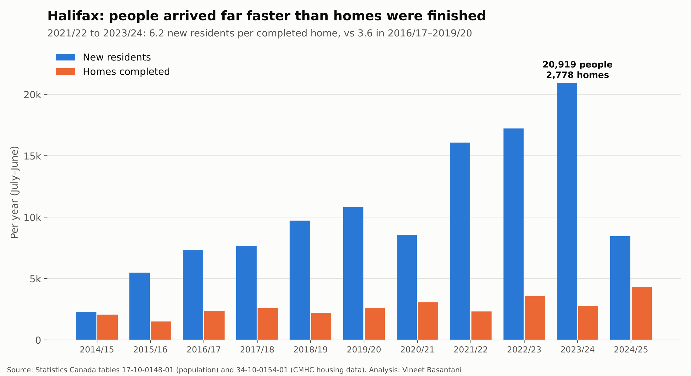
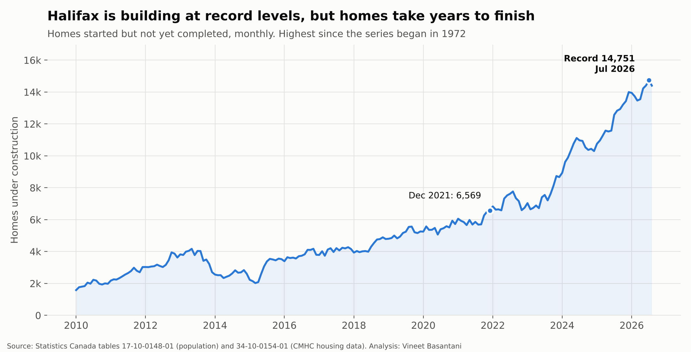

# Halifax's supply gap: people arrived faster than homes were finished

*Population: July 1 estimates by census metropolitan area. Homes: CMHC completions, starts and units under
construction. Years run July–June so both cover the same months.
Generated by [`analysis/halifax_supply_gap.py`](../../analysis/halifax_supply_gap.py).*

## Key findings

- **From 2021/22 to 2023/24, Halifax gained 54,228 residents but completed
  8,697 homes**: 6.2 new residents per finished home.
- **Before the boom (2016/17–2019/20) the ratio was 3.6.** Keeping that pace through the boom
  would have needed about 14,961 completed homes, roughly **6,300 more** than were finished.
- **Building did ramp up.** Housing starts hit 6,495 in 2023/24, the most in any year since 1972.
- **But homes take years to finish.** Units under construction reached a record **14,751** in July 2026,
  up from 6,569 in December 2021. Completions in 2025/26 were 3,016, down from 4,317
  the year before.
- **Population growth has slowed.** Halifax added 8,462 residents in 2024/25, against a peak of
  20,919 in 2023/24. If the record number of homes under construction is
  finished while growth stays slower, the gap would narrow.

## Year by year

| Year (July–June) | New residents | Homes completed | Residents per home |
|---|---:|---:|---:|
| 2014/15 | 2,292 | 2,069 | 1.1 |
| 2015/16 | 5,481 | 1,516 | 3.6 |
| 2016/17 | 7,304 | 2,382 | 3.1 |
| 2017/18 | 7,684 | 2,587 | 3.0 |
| 2018/19 | 9,727 | 2,235 | 4.4 |
| 2019/20 | 10,828 | 2,602 | 4.2 |
| 2020/21 | 8,579 | 3,058 | 2.8 |
| 2021/22 | 16,078 | 2,338 | 6.9 |
| 2022/23 | 17,231 | 3,581 | 4.8 |
| 2023/24 | 20,919 | 2,778 | 7.5 |
| 2024/25 | 8,462 | 4,317 | 2.0 |

## Notes on method

- **New residents** = change in the July 1 population estimate for the Halifax census metropolitan area (2021 boundaries).
- **Homes** count all completed dwellings (houses, apartments, condos), not only rentals.
- **The 3.6 benchmark** is Halifax's own pre-boom pace, not a target. Not every new resident needs a new home:
  a typical home holds more than two people, and newcomers sometimes move into existing homes.
- Latest under-construction figure: 14,400 (August 2026).
