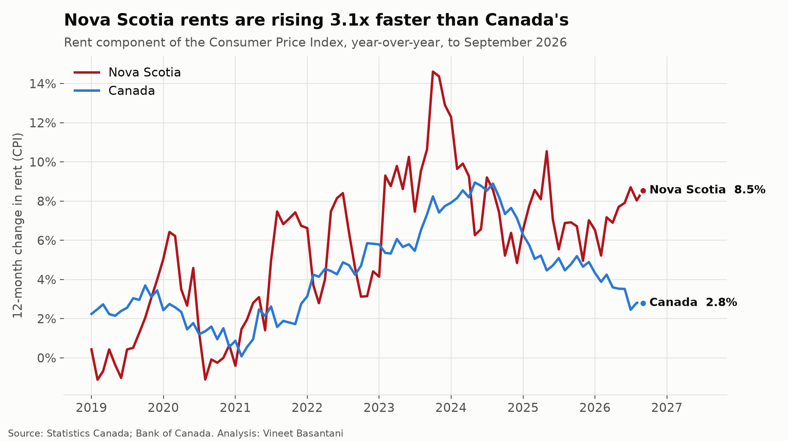
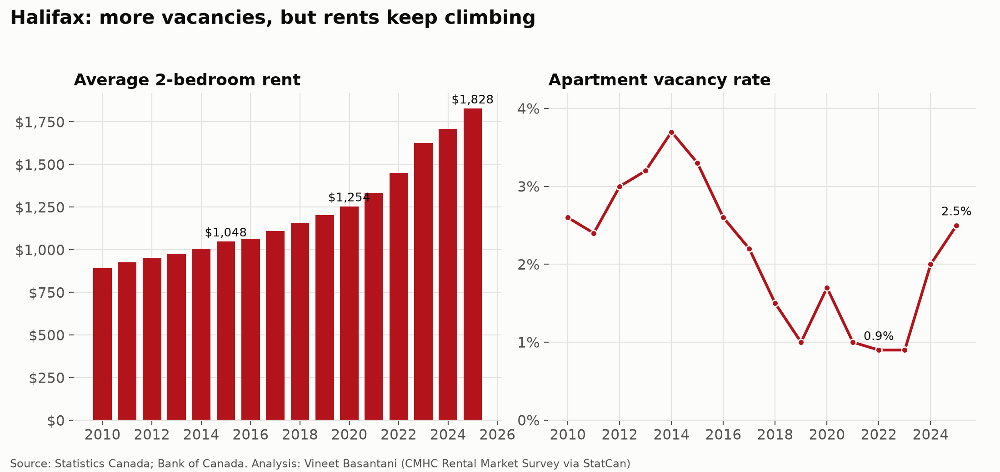
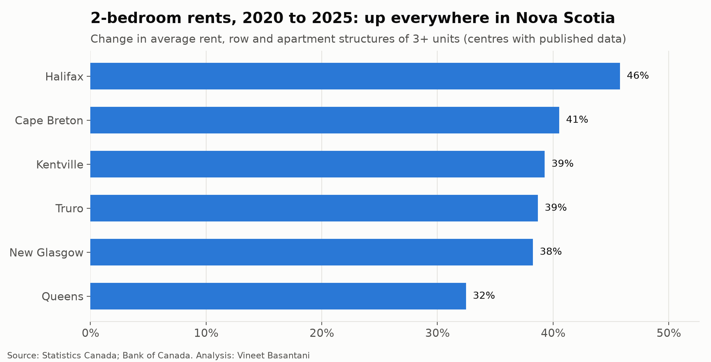
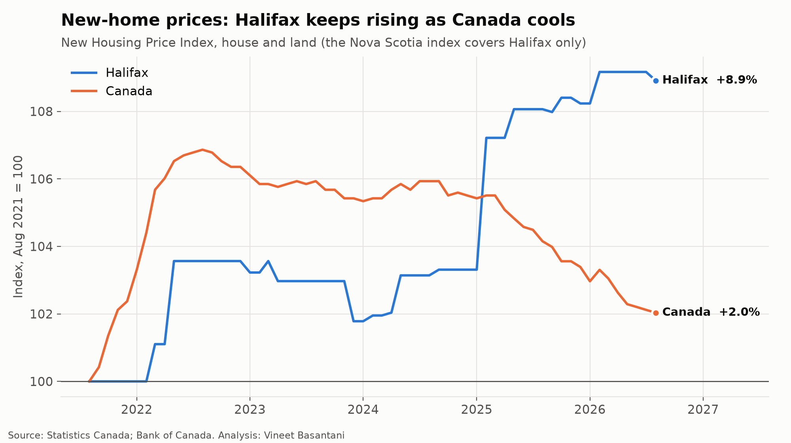

# Nova Scotia housing: rents outpace the country

*Data to September 2026 (CPI), August 2026 (new-home prices) and 2025 (CMHC rental survey).
Generated by [`analysis/ns_housing_report.py`](../../analysis/ns_housing_report.py) from the files in [`data/`](../../data).*

## Key findings

- **Rent inflation in Nova Scotia is 8.5%**, against 2.8% for Canada
  (12 months to September 2026). Over five years NS rents are up 44.2%, against 30.4% nationally.
- **Overall NS inflation is 5.6%**, against 3.1% for Canada, with shelter at 7.8%.
- **A Halifax 2-bedroom averaged $1,828/month in 2025**, up 46% from $1,254 in 2020,
  even though vacancy rose from a low of 0.9% to 2.5%.
- **Every Nova Scotia centre with published data saw 2-bedroom rents rise 32%–46% over five years.**
- **New-home prices: Halifax +0.8% over the past year, Canada -2.0%.**
  Over five years Halifax is +8.9% and Canada +2.0%.
- **The posted 5-year conventional mortgage rate is 6.19%** (Oct 14, 2026), against 4.79% in January 2021.

## Summary table

| Measure | Nova Scotia | Canada |
|---|---:|---:|
| Rent, 12-month change | 8.5% | 2.8% |
| Rent, 5-year change | 44.2% | 30.4% |
| Shelter, 12-month change | 7.8% | 1.8% |
| All-items CPI, 12-month change | 5.6% | 3.1% |

## Notes on method

- **Sources:** StatCan tables 18-10-0004-01 (CPI), 34-10-0133-01 (CMHC average rents), 34-10-0127-01 (CMHC vacancy rates),
  18-10-0205-01 (New Housing Price Index); Bank of Canada series V80691335 (5-year conventional mortgage rate).
- **Suppressed values:** StatCan marks some figures as not available (`..`) or too unreliable to publish (`F`); these are treated as missing,
  not zero. Centres without both 2020 and 2025 figures are left out of the growth chart (East Hants, West Hants, Yarmouth).
- **Rents** are for row and apartment structures of three or more units, from CMHC's annual October survey.
- **New-home prices:** StatCan's Nova Scotia New Housing Price Index covers Halifax only.
- **Mortgage rate** is the banks' posted rate; most borrowers pay less after discounts.
