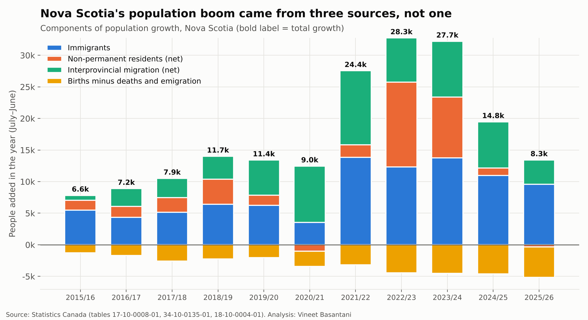
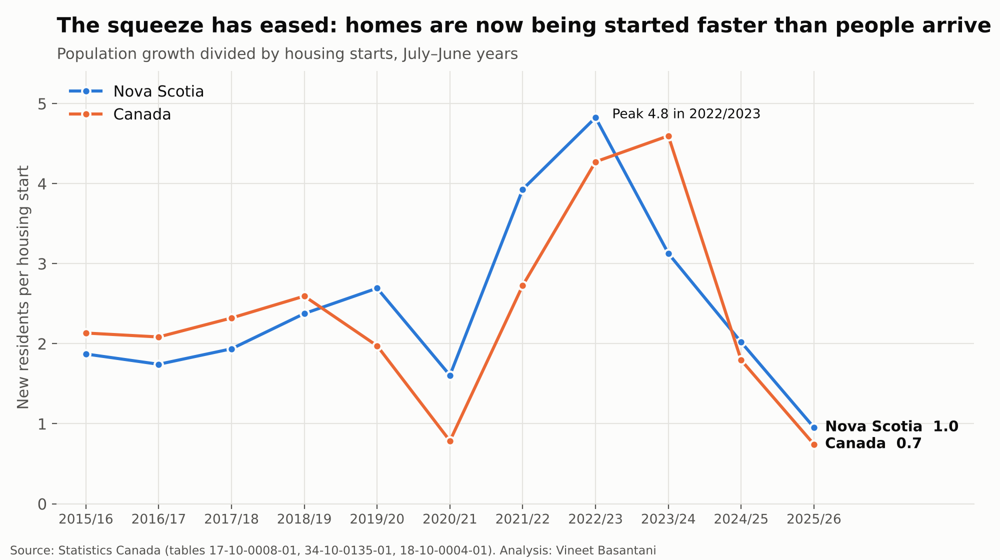
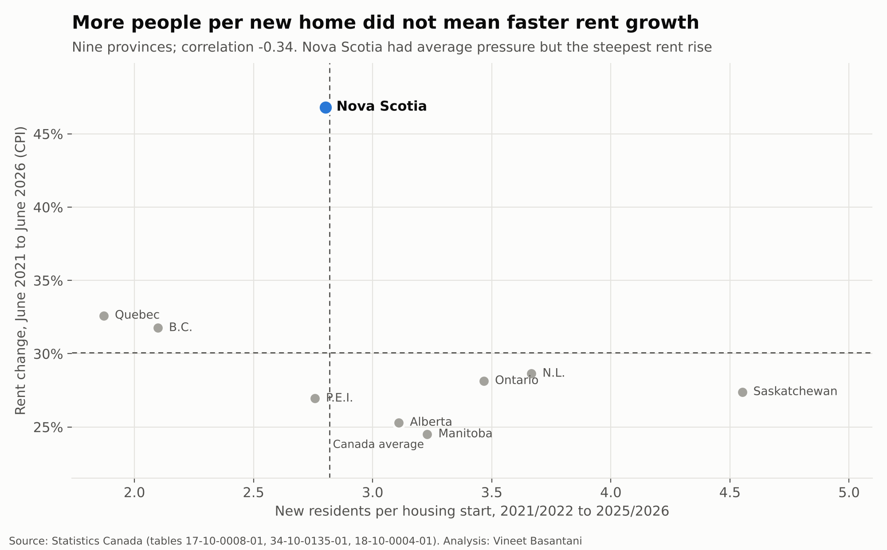

# People vs homes: did population growth drive Nova Scotia's rent surge?

*Population years run July–June; latest year 2025/2026. Rents to June 2026.
Generated by [`analysis/people_vs_homes.py`](../../analysis/people_vs_homes.py).*

## Short answer

Population growth put real pressure on Nova Scotia's housing, but it **does not explain why Nova Scotia's rents rose
faster than anywhere else**. Over 2021/2022–2025/2026, Nova Scotia added **2.80 new residents per housing
start**, almost exactly the national figure of 2.82. Yet its rents rose **46.8%**, against
30.1% for Canada, ranking #1 of 9 provinces.

## Key findings

- **Growth came from three sources, not one.** Of Nova Scotia's 103,511 added residents over 2021/2022–2025/2026:
  immigrants 60,457, non-permanent residents (students and temporary workers, net) 25,861,
  and people moving from other provinces (net) 38,709. Births minus deaths and emigration
  subtracted 21,516.
- **The peak squeeze was 2022/2023**, at 4.8 new residents per housing start
  (Canada: 4.3).
- **It has since eased sharply.** In 2025/2026 Nova Scotia added 8,262 people and started 8,666
  homes, 1.0 per start. Net non-permanent residents turned negative
  (-357).
- **Across provinces there is no positive link** between population pressure and rent growth over the last five years
  (correlation -0.34); in the five years before, it was +0.33. With nine provinces this is suggestive, not proof.

## So what else could explain it?

These are hypotheses to test next, not conclusions:

- **Starting point:** Nova Scotia rents began from a lower base, leaving more room to catch up with other provinces.
- **Lag:** housing starts take roughly two years or more to become homes people can rent, so the jump in starts since 2023/2024 has
  not yet fully shown up as supply.
- **Where people went:** if most newcomers settled in Halifax, they met a rental market with vacancy below 1% in 2022–2023
  (provincial totals can't show this; city-level population data would).
- **Who arrived:** students, temporary workers and newcomers mostly rent, so the same population growth can press harder on
  rents in a province with a small rental stock.

## Notes on method

- **Population growth** = immigrants + net non-permanent residents + net interprovincial migration + births − deaths − net emigration
  (StatCan 17-10-0008-01). Residual deviation in older years is excluded.
- **Supply** uses housing starts (34-10-0135-01, unadjusted quarters summed to July–June). The table stopped publishing
  completions after 2022, so starts are the latest consistent measure; they lead completions by a year or more.
- **Rents** are the rent component of the CPI, June to June, which covers all tenants, not only new leases.
- **Provinces compared:** Alberta, British Columbia, Manitoba, Newfoundland and Labrador, Nova Scotia, Ontario, Prince Edward Island, Quebec, Saskatchewan.
- Correlation is not causation, and nine data points cannot rule much out.
