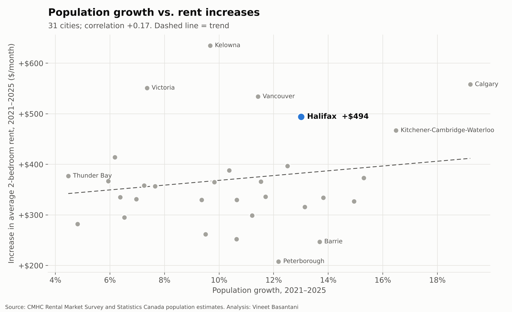
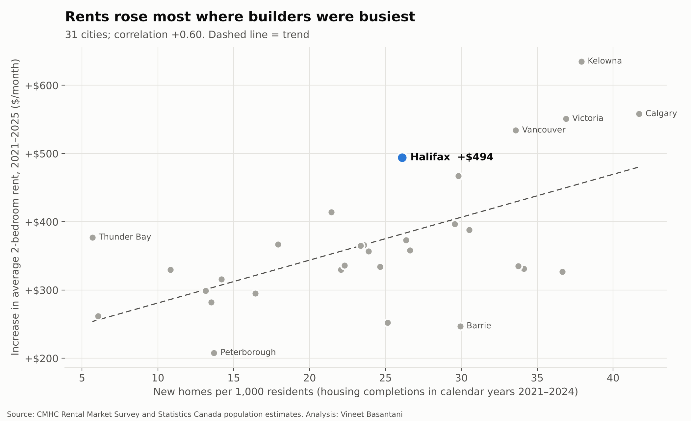
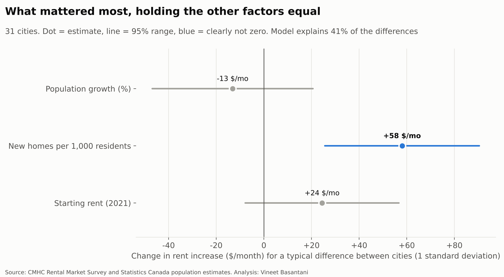

# What actually drove rent increases? Rents rose most where builders were busiest

*31 cities, CMHC October rental survey 2021–2025. Rent change is measured in **dollars per month**, so cheaper
cities don't look faster just because they started lower.
Generated by [`analysis/real_rent_factors.py`](../../analysis/real_rent_factors.py).*

## The factors, tested together

Each factor's effect is estimated with the others held constant (one regression across all 31 cities).
Together they explain **41%** of the differences in rent increases between cities.

- **Population growth (%):** 3.6 points more population growth went with **-13 $/month** in rent increase (95% range -47 to +21): not clearly different from zero.
- **New homes per 1,000 residents:** 9.4 more new homes per 1,000 residents went with **+58 $/month** in rent increase (95% range +26 to +90): a clear effect.
- **Starting rent (2021):** $264 higher starting rent went with **+24 $/month** in rent increase (95% range -8 to +57): not clearly different from zero.

## How to read this

**This does not mean building raises rents.** Builders start more homes where demand and rents are already rising,
so in a snapshot across cities, busy building and big rent increases show up together. A comparison like this
can't separate "building lowers rents" from "builders follow rising rents". Testing that properly needs timing:
whether a burst of building in one year is followed by slower rent growth a few years later.

## Halifax

- **Halifax: rent +$494/month** ($1,334 to $1,828), #5 of 31; median city +$357.
- **Halifax's population grew 13.0%** (2021–2025), #8 of 31; median 10.6%.
- **Halifax added 26 new homes per 1,000 residents**, #14 of 31; median 25.
- **Halifax built 0.20 new homes per new resident** (about 5.0 newcomers per home), against a median of 0.24 (about 4.2 per home); #11 lowest of 31.
- **The model predicts +$380/month for Halifax**; the actual was +$494.

## Notes on method

- **Rent increase:** average 2-bedroom rent, row and apartment structures of 3+ units (34-10-0133-01), October 2021 to October 2025.
- **Population growth:** July 1 estimates by census metropolitan area, 2021 boundaries (17-10-0148-01), 2021 to 2025.
- **New homes:** housing completions in calendar years 2021–2024 (StatCan 34-10-0154-01), per 1,000 residents in 2021. Homes started near the end of the
  window may not be finished yet.
- **Rental units:** StatCan did not publish a matching city-level table in this run, so this factor is left out.
- **Effects** are per one standard deviation of each factor (a typical difference between two cities), with 95% ranges.
  With 31 cities, ranges are wide; a factor "not clearly different from zero" may still matter, the data just can't show it.
- Correlation is not causation: a city can attract people *and* raise rents for a shared reason, such as job growth.
