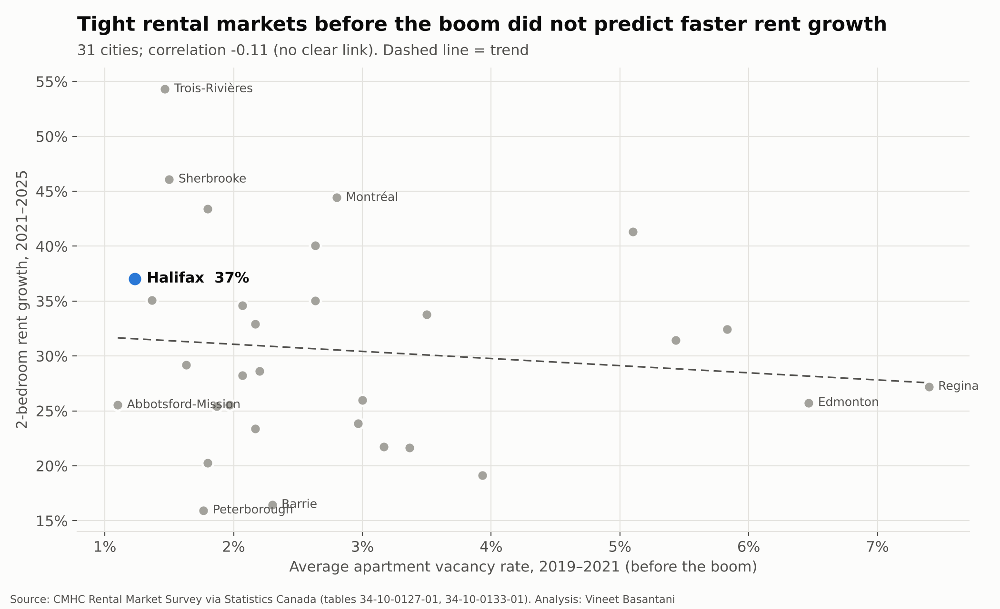
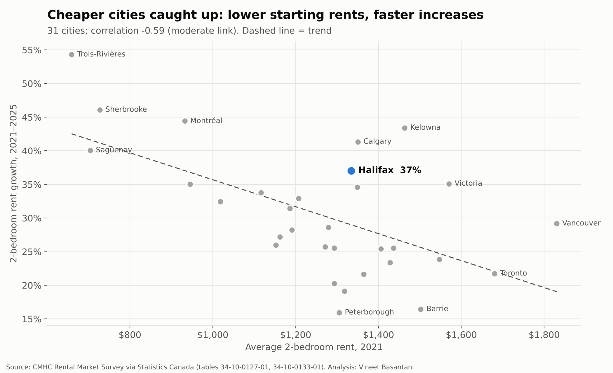
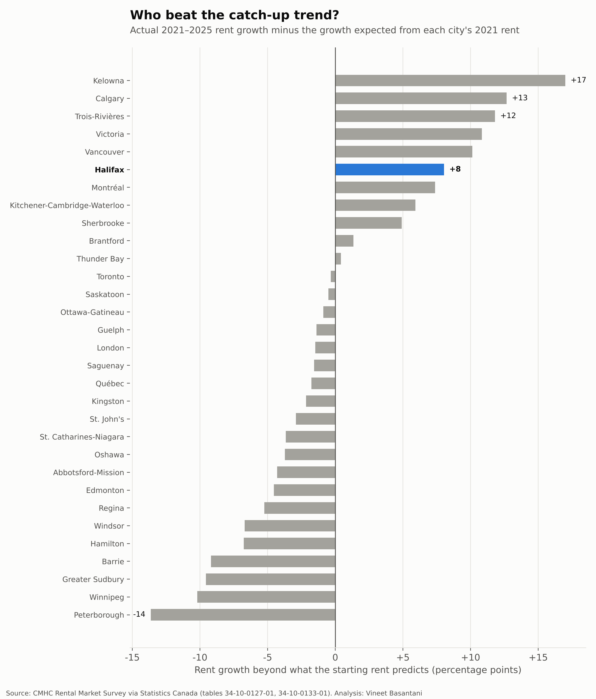

# What drove rent growth? Catch-up, not tight markets

*CMHC Rental Market Survey (October each year), 31 cities with published data in both tables.
Generated by [`analysis/what_drives_rent.py`](../../analysis/what_drives_rent.py).*

The [people vs homes](../people-vs-homes/README.md) report found that population pressure doesn't explain why
Nova Scotia's rents rose fastest. This report tests two other explanations across Canadian cities:

1. **No slack:** did cities with fewer empty apartments *before* the boom see bigger rent increases?
2. **Catch-up:** did cities with cheaper rents see bigger increases as they converged on pricier markets?

## Key findings

- **Halifax's 2-bedroom rent grew 37.0%** from 2021 to 2025 ($1,334 to $1,828), #7 of 31 cities; the median city grew 28.6%.
- **Halifax went in with 1.2% vacancy** (2019–2021 average), against a median of 2.2%; #2 tightest of 31.
- **Vacancy going in vs. rent growth: correlation -0.11** (no clear link). On the trend line, each 1-point-lower vacancy rate goes with 0.7 points more rent growth.
- **Starting rent vs. rent growth: correlation -0.59** (moderate link). Each $100 lower starting rent goes with 2.0 points more rent growth.
- **Catch-up alone predicts 29% growth for Halifax; it actually grew 37%**, +8 points beyond the trend (#6 of 31). The biggest overshoots: Kelowna (+17), Calgary (+13), Trois-Rivières (+12), Victoria (+11), Vancouver (+10).
- **Together the two factors account for 38% of the variation** in rent growth across cities (R²).

## Notes on method

- **Rent growth:** average 2-bedroom rent, row and apartment structures of 3+ units (34-10-0133-01), 2021 to 2025.
  This covers all tenants, including long-term ones whose rent rises slowly.
- **Vacancy going in:** average apartment vacancy rate over 2019–2021 (34-10-0127-01), before the population boom.
- **Cities:** every census metropolitan area with published figures for all three measures; suppressed values are excluded.
  Full list in [`cities.csv`](cities.csv).
- **"Beyond the trend"** uses a straight-line fit of rent growth on 2021 rent across all 31 cities.
- Correlation is not causation. Both factors can share causes, and city-level averages hide neighbourhood differences.
